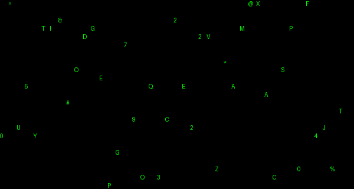

# 🟢 Matrix Digital Rain Effect




A lightweight, customizable Matrix falling code animation built in two versions: a smooth **HTML5 Canvas web version** and a zero-dependency **Python terminal script**.


## ✨ Features
* **Web Version (`index.html`):** Smooth 30fps HTML5 `<canvas>` animation with glowing fade trails that automatically adapts to any screen size.
* **Terminal Version (`matrix.py`):** Runs directly inside your command prompt or terminal using only Python's built-in standard libraries (`random`, `shutil`, `time`).
* **Easy Customization:** Change colors, falling speed, character sets, and trail length by editing a single line of code.

---

## 🚀 How to Run

### 1. Web Version (`index.html`)
* **Option A (Live Demo):** Enable **GitHub Pages** in your repository settings (`Settings > Pages > Branch: main`) to view it live in any browser.
* **Option B (Local):** Download or clone this repository and double-click `index.html` to open it in Chrome, Edge, or Safari.

### 2. Python Terminal Version (`matrix.py`)
Make sure you have Python 3 installed, then run the script from your terminal:

```bash
python matrix.py
```
*(Press `Ctrl + C` at any time to stop the animation).*

---

## 🎨 Customization (`index.html`)

Open `index.html` in any code editor to tweak the look:

| Setting | Line in Code | What to Change |
| :--- | :--- | :--- |
| **Text Color** | `ctx.fillStyle = '#0F0';` | Swap `#0F0` for any hex code (e.g., `#00BFFF` for blue, `#FF007F` for pink). |
| **Falling Speed** | `setInterval(draw, 33);` | Lower `33` to `15` for faster rain, or raise to `70` for slower rain. |
| **Trail Length** | `rgba(0, 0, 0, 0.05)` | Lower `0.05` to `0.02` for longer tails, or raise to `0.15` for shorter drops. |

---

## 📂 Project Structure
```text
├── index.html   # Browser-based HTML5 Canvas animation
├── matrix.py    # Terminal-based Python script
└── README.md    # Project documentation
```
